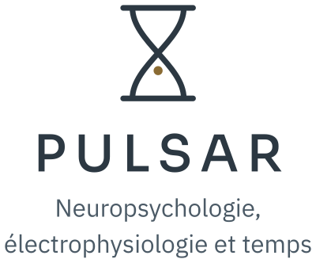

<p align="center">
  
</p>

# Site web de Pulsar Lab

Site bilingue de Pulsar Lab (laboratoire Pulsar), dirigé par Nicola Thibault, Ph. D., au Département des sciences de la santé de l'Université du Québec à Rimouski (UQAR). L'anglais est à la racine du site, le français sous `/fr/`.

## Aperçu local sur Mac

```bash
./apercu.sh
```

Au premier lancement, le script télécharge la version de Hugo fixée dans `hugoblox.yaml`, installe les dépendances Node, puis ouvre l'aperçu sur http://localhost:1313/. Les pages se mettent à jour à chaque modification. Il faut Go, Node et pnpm, installés avec Homebrew.

## Organisation

- `content/en/` et `content/fr/` : les pages, dans chaque langue.
- `data/authors/` : les fiches des membres (`data/fr/authors/` pour le français), photos dans `assets/media/authors/`.
- `marque/` : l'identité visuelle (logos, polices, couleurs). Lire `marque/MARQUE.md` avant toute décision visuelle.
- `config/_default/` : la configuration de Hugo et de Hugo Blox.
- Publications : importées depuis ORCID par le flux GitHub `sync-orcid-publications.yml`, lancé à la main.

## Crédits

Gabarit adapté de [rempsyc/lab](https://github.com/rempsyc/lab) (Laboratoire SAGE, Rémi Thériault), lui-même issu de [Hugo Blox](https://hugoblox.com), sous licence MIT (`LICENSE.md`). Polices Sora, Urbanist et IBM Plex Sans (grec) sous licence SIL Open Font License (`marque/polices/`).
